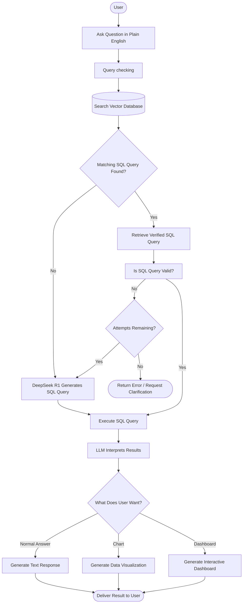

# atlas

user as question in plain English that question is converted to sql query and user get the ans. in text. if he ask for chart he gets it. he can also create a dashboard by just ask for it.

how its build. we train DeepSeek R1 on queries that we get from clients and the ones we generated. we double check each sql query. also we try to cover as many possible sql queries as possible. we create their questions. then we create derivatives of each question and answer pair. we use all of that data to train  DeepSeek R1. and save all the data in a vector database. 
workflow: user ask question -> check vector database if sql query found use that else generate sql query with LLM -> check another LLM check the validity of the query if vaild use that else regenerate (max 3 tries) -> excute sql -> llm ans your question or generate chart. 

