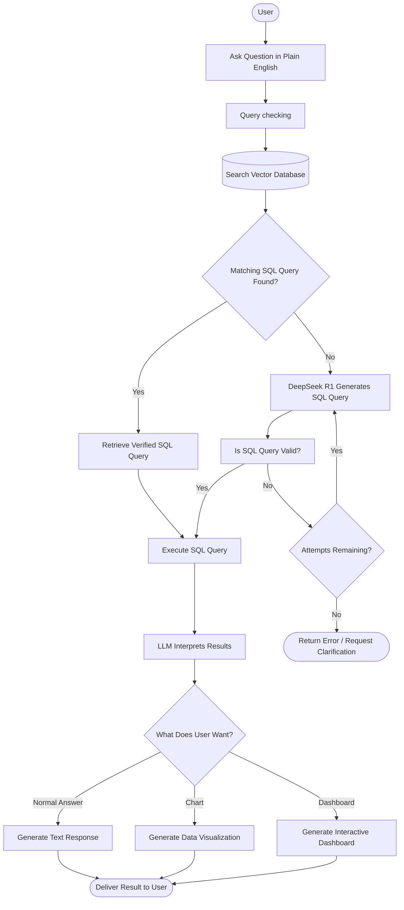

# atlas

## Natural Language to SQL AI Agent

## Core Concept

Users interact with their business databases using plain English instead of writing SQL queries. The system understands the user's question, retrieves an existing verified SQL query from a vector database or generates a new one using fine-tuned DeepSeek R1. A separate LLM validates the SQL query before execution.

Once executed, the system interprets the results and delivers the requested output.

## Output Modes

The system supports three output modes:

- **Text:** Direct answers to business questions in natural language.
- **Charts:** Visual representations of queried data.
- **Dashboards:** Interactive dashboards generated from natural-language instructions.

## Technology and Architecture

- **DeepSeek R1:** Fine-tuned for natural-language-to-SQL generation.
- **Vector Database:** Stores embeddings of verified question-SQL pairs and their variations for semantic retrieval.
- **LLM Validator:** Independently validates SQL queries before execution.
- **SQL Database:** Executes validated queries and returns results.
- **CrewAI:** Orchestrates the agent workflow and coordinates the different stages of processing.

## Important Implementation Details

Both retrieved and newly generated SQL queries pass through an independent validation process before execution.

If a query fails validation, the system sends it back for regeneration. This process allows a maximum of three attempts. If validation still fails, the system returns an appropriate error instead of executing an invalid query.

## Data Preparation and Model Training

1. Collect SQL queries from clients and generate additional SQL examples.
2. Manually review and verify each SQL query for correctness.
3. Create natural-language questions corresponding to the verified SQL queries.
4. Generate multiple variations and derivatives of each question-and-SQL pair.
5. Use the expanded dataset to fine-tune DeepSeek R1.
6. Generate embeddings for the question-and-SQL pairs and store them in the vector database.

This approach improves SQL generation and retrieval by covering a wide range of possible business questions and their different natural-language variations.

## Flowchart

user as question in plain English that question is converted to sql query and user get the ans. in text. if he ask for chart he gets it. he can also create a dashboard by just ask for it.

how its build. we train DeepSeek R1 on queries that we get from clients and the ones we generated. we double check each sql query. also we try to cover as many possible sql queries as possible. we create their questions. then we create derivatives of each question and answer pair. we use all of that data to train  DeepSeek R1. and save all the data in a vector database. 
workflow: user ask question -> check vector database if sql query found use that else generate sql query with LLM -> check another LLM check the validity of the query if vaild use that else regenerate (max 3 tries) -> excute sql -> llm ans your question or generate chart. 
